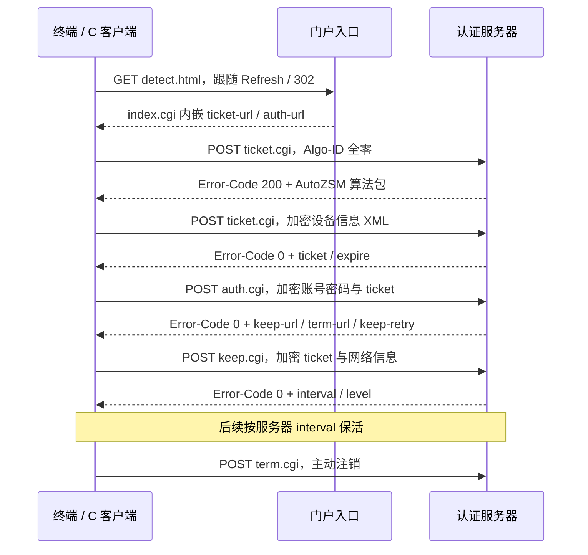

# 江苏天翼校园 HTTP Portal 协议分析

## 流程与抓包证据



日志记录的入口为 `http://preportal.go189.cn/detect.html`，经历 Refresh/302，最终进入 `preportal.go189.cn/index.cgi?...`。门户配置位于：

```html
<!--//config.campus.js.chinatelecom.com
... <ticket-url>...</ticket-url><auth-url>...</auth-url> ...
//config.campus.js.chinatelecom.com-->
```

ticket/auth URL 的 query 含 `tag`、`wlanuserip`、`mscgip`、`wlanusermac`、`userlocation`。它们属于当前接入环境，C 客户端应重新发现，不能硬编码旧 Windows 会话的整条 URL。

## HTTP 包装

请求使用 `POST`，`Connection: close`，`User-Agent: CCTP/WinSVR5/1069`，附带：

- `Client-ID`：UUID，同样出现在 XML。
- `Algo-ID`：第一次为全零 UUID；后续取服务器算法包内 ID。
- `CDC-Checksum`：HTTP **原始正文字节**的 MD5，32 字符小写十六进制。

这份抓包没有请求 Content-Type。HTTP 200 仅表示 HTTP 请求成功，业务结果必须看 `Error-Code`：样本中 200 表示下发算法，0 表示当前操作成功。其他错误码未建立完整含义表。

第一次正文精确为以下 38 字节，`tarce` 是原文拼写：

```text
tarce log algo auto compstr null value
```

## 加密 XML

原抓包 Wire 格式为：UTF-8 XML → NUL 结尾与零填充 → 两次 3DES-EDE ECB → 大写十六进制 ASCII。2026-10-07 从 OpenWrt 另行下载的包改用下面记录的三层变体 TEA。

填充规则是追加 `8 - (XML长度 % 8)` 个零字节；即便 XML 恰好对齐，也追加一个完整零块。不是 PKCS#7。每个 8 字节块使用六个 DES 密钥 `K0..K5`：

```text
加密（按执行顺序）：E(K3), D(K4), E(K5), E(K0), D(K1), E(K2)
解密（按执行顺序）：D(K2), E(K1), D(K0), D(K5), E(K4), D(K3)
```

DES 本身是标准 DES。CBC IV 长度为 0，实际模式为 ECB。`CDC-Checksum` 对加密后的 ASCII 十六进制正文计算，不能对解码后的二进制密文计算。

### OpenWrt 新包：三层变体 TEA

以下 RVA 来自静态反汇编。密钥读取函数位于 `0x6c4c`：密钥基址 `0xf0e0`，偏移由 `0xf1de` 指定，本包为 17；密钥长度字节 `0xf1db` 为 48，IV 长度字节 `0xf1d9` 为 0。将 48 字节分成三把 16 字节密钥，不能沿用 DES 的六把 8 字节密钥解释。

分组函数位于 `0x6cc0`，每组 8 字节，分组与密钥均按大端读取 32 位整数。每把密钥执行 32 轮，初始 `sum=0`，每次运算对 `2^32` 取模：

```text
L += ((R << 4) XOR (R >> 5)) + (R XOR sum) + K[sum & 3]
sum += 0x9e3779b9
R += ((L << 4) XOR (L >> 5)) + (L XOR sum) + K[(sum >> 11) & 3]
```

这不是标准 XTEA：上述三个部分之间使用加法。加密包装函数 `0x8b30` 对每个分组依次使用密钥 0、1、2；解密函数 `0x8d64` 使用 2、1、0 并逆向计算各轮。仍为 ECB、NUL 结尾与零填充、大写十六进制输出。这里的大端顺序与外层包解密的小端顺序不同。`local-time` 预处理在 `0x89a3` 同样使用 RDTSC，因此现有近似实现没有变更。

验证包含从算术指令逐条生成的独立 C 参考计算（128 组数据分别比较加密与解密，共 256 次）、固定加密向量，以及原 DES 抓包回归；没有执行服务器下发的 Windows DLL。新包没有附带成功认证报文，在线兼容性仍待实测。

请求 XML 声明为 `<?xml version="1.0" encoding="utf-8"?>`，请求根内各顶层元素以换行分隔。样本字段如下：

| 请求 | XML 字段顺序 |
|---|---|
| ticket | ostag、local-time、gwip、mac、ipv6、ipv4、client-id、user-agent、host-name |
| auth | local-time、ticket、passwd、userid、client-id、user-agent |
| keep | local-time、excheck-args、mac、ipv6、ipv4、ticket、client-id、user-agent |

`passwd` 是账号原始密码，并没有再做前端 SM4。Electron 中的 SM4 用于本地保存，不是此线路 HTTP 正文的加密方式。C 客户端从交互输入或私有凭据文件读取密码，未将抓包恢复出的凭据写入源代码。

登录响应还包含 `user-config/against-interval=10`，以及进程、驱动等检查配置。该 10 秒值不是 HTTP 保活周期；实际首个保活响应为 300 秒。

`local-time` 的算法来自 DLL 的 `0x18000914d`：读取 RDTSC，右移 34 位，以每 6 bit 加 `0x30` 编码为九个字符。样本为 `00000002d`，表示数值 180。macOS/Linux 实现目前以单调时钟纳秒值代替 TSC 输入，服务器对该值的校验要求尚未确定。

## AutoZSM 下载包与静态提取

| 偏移 | 内容 |
|---|---|
| 0..2 | ASCII `001` |
| 3 | 第一个字符串长度，0x40 |
| 4..67 | 64 字符十六进制元数据，含义未确定，未作为已验证的校验和使用 |
| 68 | 第二个字符串长度，0x24 |
| 69..104 | Algo-ID UUID |
| 105..109 | LZMA 属性，本包为 `5d00000001` |
| 110..113 | little-endian 32 bit：高四位类型=2，低28位解压长度=65536 |
| 114..末尾 | 加密压缩数据 |

类型 2 使用两次变体 TEA 解密。变体中的组合运算为 `((v<<4) XOR (v>>5)) + (v XOR sum) + key[index]`，不是直接套用标准 XTEA。解密后最后一字节表示需移除的尾部长度，其前面的填充字节不要求相同；再用 LZMA raw 解压。这份流不带 EOS 标记，必须按包头指定的输出长度停止；不能额外尝试解压第 size+1 字节，否则部分有效流的编码尾部会多解出符号。原生解码器以该长度为输出上限，C 实现对齐这一行为，并拒绝解压后不足指定长度的数据。

DLL 并非必须在 Linux 加载执行。C 实现验证已识别的 `.text`、`.rdata` 和 DES 表，然后从 RVA `0x115c0 + byte[0x116be]` 提取48字节密钥；RVA `0x116bb` 是密钥长度，`0x116b9` 是 IV 长度。样本 key offset=19、key length=48、IV length=0。

目前识别三种算法模板（双层 3DES-ECB、双层 3DES-CBC、三层变体 TEA）；未识别的模板仍会触发拒绝处理，同模板的数据密钥变化可以静态读取。尚未证明运营商未来下发的所有版本都兼容。

## 完整安装目录补充的证据

`WndInterface.node` 通过命名管道 `\\.\pipe\ESurfingClientPipe` 把界面消息交给 `ESurfingSvr.exe`。真正的 Portal 网络逻辑位于 `Mods/PortalServer.zem`，不是 Electron UI。

ZEM 模块经相邻块 XOR、变体 TEA 和 LZ4 解包，可得到 `PortalServer.dll`、`DialServer.dll`、`Helper.dll`。本次只静态解析、反汇编这些文件，没有运行其 Windows 代码。

`PortalServer.dll` 的保活 XML 构造函数在 `0x18004b90c` 起检查两个端口，端口为空或字符串 `0` 时会跳过 `excheck-args`。抓包实际报告 hello=55118、conn=49743；另有一条从55118端口发往 `8.8.8.8:8080` 的8字节 UDP 数据。静态代码也包含 UDP 发送和本地端口读取逻辑。这些端口不是密码散列或固定魔数，不应把抓包值复制成新的运行参数。

C 客户端使用原生支持的“省略字段”形态，但服务器是否允许省略、是否会后续下发检测命令，没有现有抓包可证明。程序没有伪造成功的额外检测结果。

注销构造函数位于 `0x18004ccb0`，包含 user-agent、client-id、ticket、local-time、reason。日志记录用户主动退出为 `DisConnect For 1`，随后 `term.cgi` 返回业务成功；实现采用 reason=1。尚需实际注销抓包验证。

## 验证范围

原研究项目的离线验证记录确认：6 条密文完全还原、3 条请求 XML 重建一致、4 个请求 checksum 一致。当时抓包中的凭据仅在验证进程内存中参与比对。这是迁移前的历史记录；本仓库不包含原验证器、测试或抓包，本次整理未重新执行验证。

这些测试能证明已捕获交互的编解码与字段构造；不能证明省略检测端口的 Linux 客户端已被服务器接受，也不能证明 macOS/ARM 计数值和长期保活满足所有要求。下一步是在相同接入线路上运行程序，对照登录、至少两到三轮保活和主动注销的新抓包。


## CBC 模板

离线反汇编：`0x180006dbc` 读取密钥及 IV；加密函数 `0x180009318` 的 `0x1800094dd..0x18000953c` 用后三把密钥做第一层 CBC，`0x180009570..0x1800095c2` 用前三把密钥做第二层 CBC，分别重置为原始 IV。解密函数 `0x18000965c` 按相反层次从尾部回溯，以保留每层的前一密文块。C 实现用独立的前块缓冲正向解密，原研究项目曾用 Python 参考实现与其逐字节比较，该参考实现未迁入本仓库。两层 CBC 使用相同 IV，不等同于对双层 ECB 整体添加一层 CBC。

模板识别仍是代码及只读段的严格白名单，不因元数据形似而接受未知代码。旋转的密钥和 IV 来自本次服务器响应，不保存在发布文件中。

## 与 C 实现的对应关系

| 模块 | 入口与职责 |
| --- | --- |
| [`crypto.c`](../cclient/src/crypto.c) | `algorithm_load` 解析 AutoZSM、解密与 LZMA 解压；`load_image` 校验 PE 模板和提取密钥/IV；`encrypt_xml` / `decrypt_xml` 编解码正文 |
| [`des_tables.h`](../cclient/src/des_tables.h) | DES 的标准置换、扩展、轮移位和 S-box 表，同时用于核对下载映像中的 DES 表 |
| [`protocol.c`](../cclient/src/protocol.c) | `discover` 发现门户，`negotiate` 协商算法，`login_client` / `keep_client` / `logout_client` 管理协议交互；Expat 解析 XML |
| [`network.c`](../cclient/src/network.c) | `network_identity` 读取接口 IPv4、MAC、网关，生成稳定客户端 ID |
| [`main.c`](../cclient/src/main.c) | 凭据读取、登录/保活循环、退避重连、信号及永久错误暂停 |
| [`esurfing.init`](../cclient/openwrt/files/esurfing.init) | UCI 参数转为命令行，procd 托管，网络事件通知客户端刷新会话 |

C 客户端为算法包设置 2 MiB 上限，为 XML 设置 32 KiB 上限，拒绝 DTD 和额外检测命令。凭据来自权限为 `0600`（或只读 `0400`）的两行 UTF-8 文件或交互输入；不依赖原研究项目的 JSON 配置与 Python 模块。
